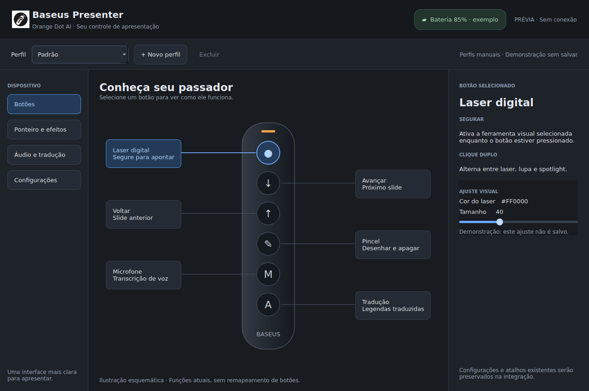
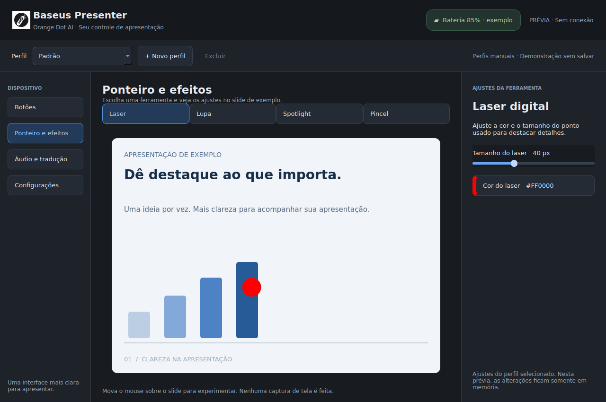
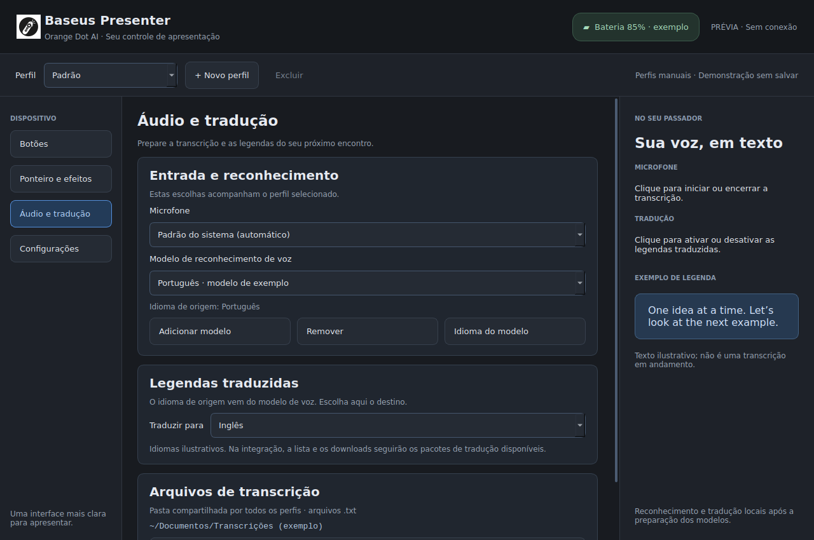
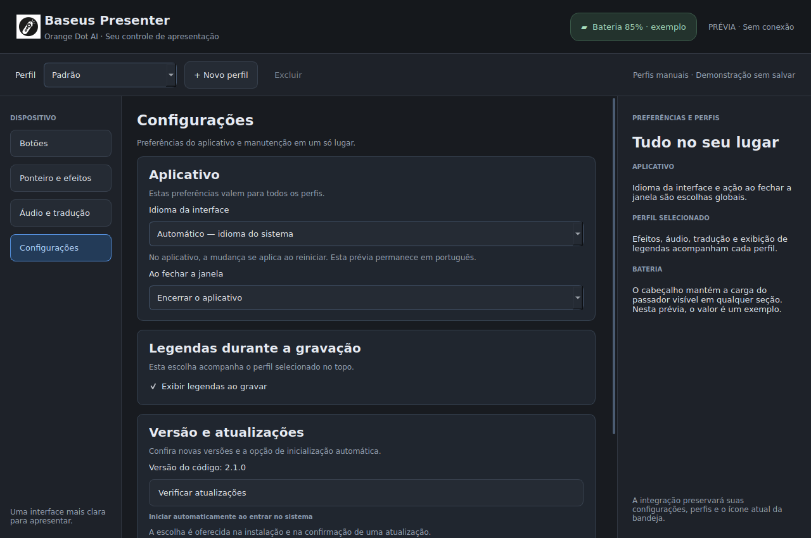

# Prévia da tela Botões

Primeira proposta inspirada na organização da referência OpenLogi: navegação lateral, passador no centro e detalhes do botão à direita. A ilustração é esquemática; deve ser conferida com o dispositivo antes da integração. O mockup não importa módulos do aplicativo, não acessa hardware nem salva configurações. Outras seções aparecem desativadas por estarem fora desta etapa.

Abrir a prévia interativa, na raiz do repositório:

```bash
.venv/bin/python tools/ui_preview.py
```

Conferir interações e exportar a imagem sem abrir uma janela:

```bash
QT_QPA_PLATFORM=offscreen .venv/bin/python tools/ui_preview.py --check --screenshot docs/ui/buttons-preview.png
```



O PNG original de Gabriel está em `app/resources/baseus-presenter.png`. A janela usa esse recurso e o QApplication herda seu ícone; desktopFileName identifica baseus-presenter. Novas instalações e atalhos de autostart criados pelo updater referenciam o PNG incluído em app/. O ícone da bandeja continua input-mouse. Os launchers já instalados no perfil do usuário não foram modificados; atalhos antigos podem continuar mostrando o ícone anterior até serem atualizados. Dock/agrupamento no GNOME e o ícone de uma instalação real ainda exigem validação manual.

A GUI principal mantém o layout existente. Integração da nova tela e demais seções aguardam avaliação visual de Gabriel. O protótipo está em português; a integração futura deverá preservar o suporte português/inglês já existente.

## Perfis na prévia — 2026-10-15

Faixa global com seletor, Novo perfil e Excluir. Criar copia o ajuste demonstrativo do perfil ativo; alternar restaura o valor de cada perfil em memória; nomes duplicados são recusados; exclusão pede confirmação e fica desativada quando há só um perfil. Não lê nem altera os perfis reais. O self-check cobre criação, cópia, alternância, duplicata, cancelamento de exclusão e preservação do último perfil. O desenho do passador segue esquemático; modelo 3D fiel depende de fotos/medidas e de etapa própria de integração. Próxima seção de design: Ponteiro e efeitos.

## Ponteiro e efeitos — 2026-10-15

Segunda seção disponível pela navegação lateral. Laser (tamanho/cor), lupa (tamanho), spotlight (área/escurecimento) e pincel (cor), com limites iguais aos sliders da GUI atual. Prévia usa slide local desenhado por QPainter; a lupa amplia esse pixmap, o spotlight mascara a imagem e o pincel mostra um traço de amostra. O mouse move o centro das ferramentas dentro da demonstração. Não há captura de tela, overlay de desktop ou acesso ao passador. Isso não valida suporte Wayland.

Os perfis agora guardam os seis parâmetros visuais em memória, com cópia independente ao criar perfil. O tamanho e a cor do laser são sincronizados com a página Botões. Seletores de cor permitem cancelar sem alteração. Outras seções ainda indisponíveis: Áudio e tradução e Configurações.

```bash
.venv/bin/python tools/ui_preview.py --page effects
QT_QPA_PLATFORM=offscreen .venv/bin/python tools/ui_preview.py --check --page effects --screenshot docs/ui/effects-preview.png
```



Self-check inclui navegação, quatro modos, sliders, escolha/cancelamento de cor, cópia/isolamento entre perfis, sincronização com Botões e renderização nos limites máximos. Capturas também conferidas em 1120x800. Sem suíte de produção nesta etapa, pois só a prévia foi alterada. Próxima seção: Áudio e tradução.

## Áudio e tradução — 2026-10-15

Terceira seção: microfone, modelo de reconhecimento e seu idioma de origem, idioma de destino das legendas, pasta global para transcrições .txt e instruções dos botões do passador. As escolhas de microfone/modelo/tradução acompanham cada perfil em memória; a pasta é global como no aplicativo atual.

Microfones, modelos, idiomas e legendas são exemplos explícitos. Adicionar/remover/idioma do modelo mostram explicações, sem alterar catálogo ou arquivos. Alterar pasta recebe um caminho demonstrativo por diálogo, sem criar nem abrir diretórios. Não são usados microfone real, Vosk, Argos, rede, arquivos de configuração ou seletor nativo de pastas. Rolagem mantém os controles legíveis e acessíveis em 1120x800.

```bash
.venv/bin/python tools/ui_preview.py --page audio
QT_QPA_PLATFORM=offscreen .venv/bin/python tools/ui_preview.py --check --page audio --screenshot docs/ui/audio-preview.png
```



Self-check cobre navegação, idioma de origem, escolhas independentes por perfil, destino global, cancelamento e ações simuladas do catálogo. Próxima seção: Configurações. A nova GUI real continua aguardando aprovação do conjunto e integração posterior.

## Configurações e bateria global — 2026-10-15

Quatro seções navegáveis concluídas como prévia. Cabeçalho compartilhado mostra bateria 85% explicitamente como exemplo, sem ler dispositivo; integração futura usará battery_update existente e preservará a bandeja.

Configurações: idioma da interface e comportamento ao fechar globais; exibir legendas ao gravar por perfil; versão lida do arquivo version do checkout; botões de atualização/desinstalação simulados por mensagens. A opção de autostart é descrita no fluxo atual da instalação/confirmação de atualização, sem criar novo mecanismo de configuração. Idioma/fechamento selecionados não alteram idioma nem fechamento da própria prévia. Nenhum acesso à rede, encerramento de processos, desinstalação ou edição de atalhos ocorre por esses botões.

```bash
.venv/bin/python tools/ui_preview.py --page settings
QT_QPA_PLATFORM=offscreen .venv/bin/python tools/ui_preview.py --check --page settings --screenshot docs/ui/settings-preview.png
```



Self-check verifica quarta página, bateria visível em todas as seções, globais preservados ao trocar perfil, legendas independentes por perfil e ações simuladas. Rolagem até desinstalação e bateria conferidas em 1120x800. Todas as capturas foram atualizadas com o cabeçalho novo. Próxima etapa: aprovação do conjunto e planejamento da integração da GUI real, preservando configurações, sinais, traduções e restrições de checkout.

## Integração aprovada — 2026-10-15

A MainWindow real agora usa as quatro seções aprovadas. Composição em app/gui_layout.py, tema em app/gui_style.py e ilustrações locais em app/gui_visuals.py. Produção não importa tools/. O desenho do passador segue esquemático; o visualizador 3D é uma frente separada.

Os controles reais preservam configurações/perfis, microfones detectados, catálogo de modelos, idiomas disponíveis, diálogos de pasta/cor, atualização e restrições de desinstalação. A bateria inicia aguardando leitura e usa o sinal existente. A prévia de efeitos dentro da janela não é uma captura de tela nem um overlay Wayland. Selecionar uma ferramenta na GUI permite editar seus ajustes; o botão do passador continua alternando o modo do overlay.

Catálogos português/inglês atualizados e compilados. Suite de 279 testes e checagem de 27 sinais aprovadas, sem hardware físico. Capturas da MainWindow com configuração temporária estão em integrated-buttons.png, integrated-effects.png, integrated-audio.png e integrated-settings.png. Dispositivos/modelos não foram inventados; os testes usam consultas de microfone e catálogo controladas. Bateria física, perfis reais e operação do passador precisam de conferência manual na nova janela. Nenhuma instalação de release ou publicação foi feita.

Para executar o checkout com hardware/áudio reais (encerre antes qualquer instância anterior):

```bash
.venv/bin/python baseus_app.py
```
